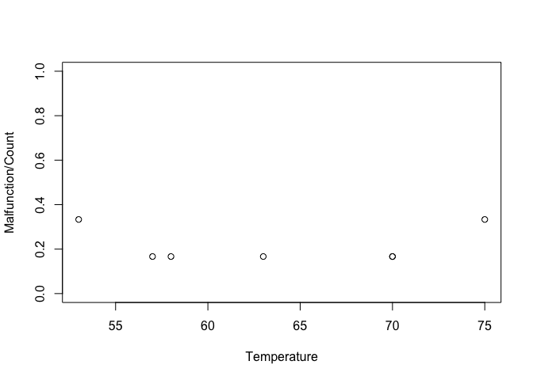
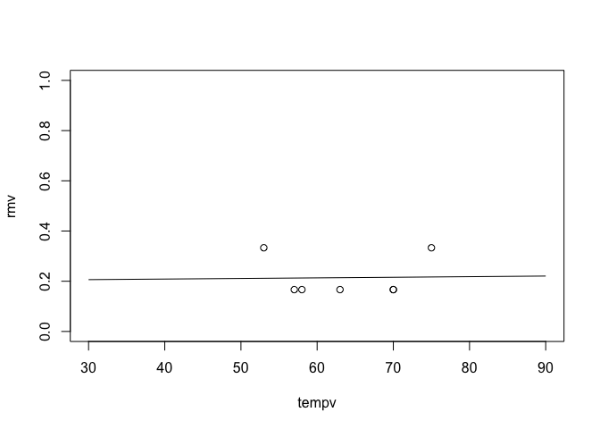
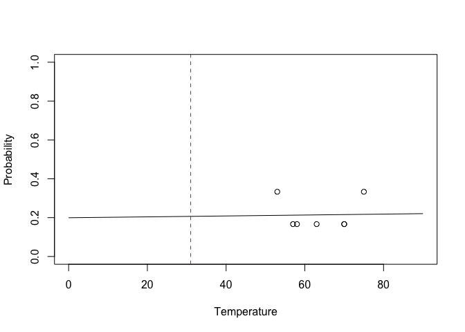

Exercise5
================
Macoveiciuc Teodor

Even before loading the data, based on the introduction we can safely
assume that they had to conduct tests in colder weathers and not rely in
scenarios they think are “reliable”.

Loading data

``` r
data = read.csv("shuttle.csv",header=T)
data
```

    ##        Date Count Temperature Pressure Malfunction
    ## 1   4/12/81     6          66       50           0
    ## 2  11/12/81     6          70       50           1
    ## 3   3/22/82     6          69       50           0
    ## 4  11/11/82     6          68       50           0
    ## 5   4/04/83     6          67       50           0
    ## 6   6/18/82     6          72       50           0
    ## 7   8/30/83     6          73      100           0
    ## 8  11/28/83     6          70      100           0
    ## 9   2/03/84     6          57      200           1
    ## 10  4/06/84     6          63      200           1
    ## 11  8/30/84     6          70      200           1
    ## 12 10/05/84     6          78      200           0
    ## 13 11/08/84     6          67      200           0
    ## 14  1/24/85     6          53      200           2
    ## 15  4/12/85     6          67      200           0
    ## 16  4/29/85     6          75      200           0
    ## 17  6/17/85     6          70      200           0
    ## 18  7/29/85     6          81      200           0
    ## 19  8/27/85     6          76      200           0
    ## 20 10/03/85     6          79      200           0
    ## 21 10/30/85     6          75      200           2
    ## 22 11/26/85     6          76      200           0
    ## 23  1/12/86     6          58      200           1

First impression looking at the samples, I think there were way too
little tests conducted. I get it that it would be costlier, but I don’t
think safety has a price. Analyzing more into it, why it took them few
years to change the pressure? Maybe it was still under development but
why not tweak it just a bit? Also, but take it just as a guess, for
around 70F degrees (about 21C), the sweet spot is at 100psi.

``` r
data = data[data$Malfunction>0,]
data
```

    ##        Date Count Temperature Pressure Malfunction
    ## 2  11/12/81     6          70       50           1
    ## 9   2/03/84     6          57      200           1
    ## 10  4/06/84     6          63      200           1
    ## 11  8/30/84     6          70      200           1
    ## 14  1/24/85     6          53      200           2
    ## 21 10/30/85     6          75      200           2
    ## 23  1/12/86     6          58      200           1

After filtering the data only to show the malfunction, keeping in mind
what was said earlier, there is my observation: you can’t have any
certain conclusion based on this little samples. First of all, 23
samples are not enough tests and having only 7 malfunctions doesn’t
really get you enough information. Second of all, the pressure for all
the malfunctions is pretty much 200psi (one exception) which again is
not enough to conclude something (if we look at the temperature it
doesn’t matter if it is colder or hotter but yet again you can’t have
something certain from this). Therefore, the conclusion is that
discarding the tests without malfunctions biases the dataset and the
analysis is not right.

How does the frequency of failure vary with temperature?

``` r
plot(data=data, Malfunction/Count ~ Temperature, ylim=c(0,1))
```

<!-- --> Frequency isn’t
impacted directly by the temperature. We can try to estimate the impact
of the temperature on the probability of O-ring malfunction.

``` r
logistic_reg = glm(data=data, Malfunction/Count ~ Temperature, weights=Count, 
                   family=binomial(link='logit'))
summary(logistic_reg)
```

    ## 
    ## Call:
    ## glm(formula = Malfunction/Count ~ Temperature, family = binomial(link = "logit"), 
    ##     data = data, weights = Count)
    ## 
    ## Coefficients:
    ##              Estimate Std. Error z value Pr(>|z|)
    ## (Intercept) -1.389528   3.195752  -0.435    0.664
    ## Temperature  0.001416   0.049773   0.028    0.977
    ## 
    ## (Dispersion parameter for binomial family taken to be 1)
    ## 
    ##     Null deviance: 1.3347  on 6  degrees of freedom
    ## Residual deviance: 1.3339  on 5  degrees of freedom
    ## AIC: 18.894
    ## 
    ## Number of Fisher Scoring iterations: 4

The most likely estimator of the temperature parameter is 0.0014 and the
standard error of this estimator is 0.122, in other words we cannot
distinguish any particular impact and we must take our estimates with
caution.

The expectation for that day was 31F. Let’s see the prediction of the
malfunction.

``` r
# shuttle=shuttle[shuttle$r!=0,] 
tempv = seq(from=30, to=90, by = .5)
rmv <- predict(logistic_reg,list(Temperature=tempv),type="response")
plot(tempv,rmv,type="l",ylim=c(0,1))
points(data=data, Malfunction/Count ~ Temperature)
```

<!-- --> It looks like
the probability stays at 0.2 but as concluded previously, this
prediction doesn’t really make sense. I think that another problem was
not only the lack of data but the arrogance and not taking the
responsibility for not having enough data. Anyway, this is how the
prediction should have looked like:

``` r
# shuttle=shuttle[shuttle$r!=0,] 
logistic_reg <- glm(cbind(Malfunction, Count - Malfunction) ~ Temperature, 
                    data = data, 
                    family = binomial)
tempv <- seq(from = 0, to = 90, by = 0.5)
rmv <- predict(logistic_reg, list(Temperature = tempv), type = "response")
plot(tempv, rmv, type = "l", ylim = c(0, 1), xlim = c(0, 90),
     xlab = "Temperature", ylab = "Probability")
points(Malfunction / Count ~ Temperature, data = data)
abline(v = 31, col = "red", lty = 2)
```

<!-- --> PS: when
knitting, the graph is As we can see with the all data set included, the
chances of malfunction are higher at lower temperatures. The red-line
represents the expected 31F temperature. We can see that the probability
is pretty high, therefore the logic of the previous graph is no longer
valid.

Last conclusion: the dataset didn’t even include the 31F temperature,
the lowest they had was 53F with 2 malfunctions, resulting in an
unprecise analysis.
